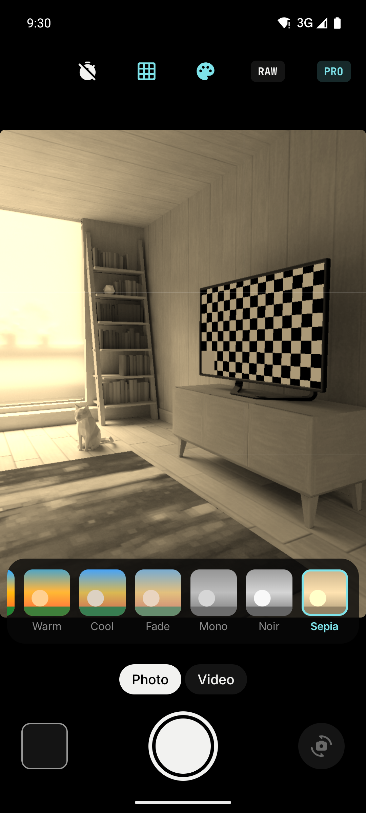
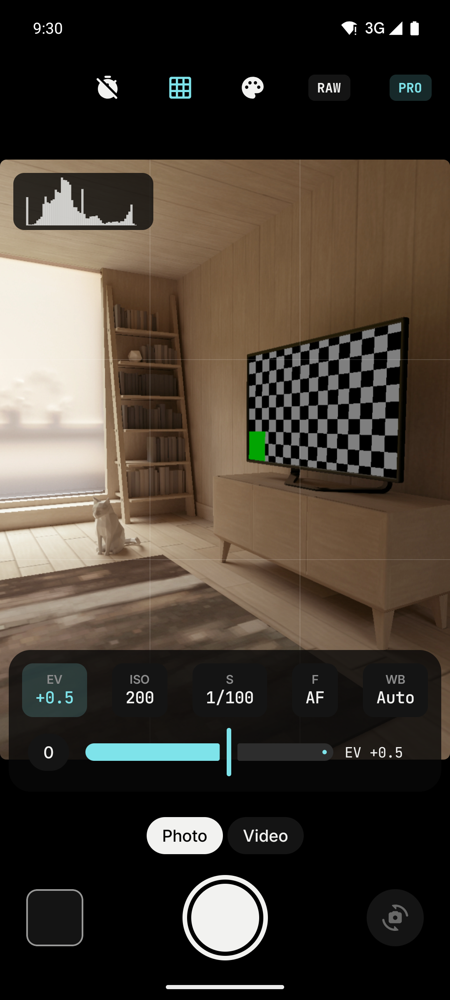

  

<h1 align="center">T.A.C.T.S.</h1>

<b>TOTTALLY ACCURATE CAMERA TECHNOLOGY SYSTEM</b>

Camera app for Android with manual controls and live looks.

  
  
  

  
  
  

## Features

**Capture**
- Photo in 4:3 and video in 16:9 (HD, FHD or 4K, falling back to what the camera supports)
- Flash off, auto or on for photos; continuous light for video
- Self-timer (3 s or 10 s) and a rule-of-thirds grid
- Tap to focus and meter, pinch to zoom, zoom presets including ultra-wide when the phone has one
- Front and back cameras, with the last capture one tap away in the gallery
- Saved to `Pictures/TACTS` and `Movies/TACTS`, visible in any gallery app
- Opens from the system camera and video camera shortcuts

**Pro**
- Exposure compensation (EV)
- Manual ISO and shutter speed in full stops, from 1/8000 s to 30 s within what the sensor allows
- Manual focus, from infinity to the lens's closest distance
- White balance presets: daylight, cloudy, shade, tungsten, fluorescent
- RAW (DNG) + JPEG on cameras that support it
- Live luminance histogram, and live ISO and shutter readouts while in auto
- Switching to manual starts from the values auto had chosen; manual values are shown in amber

**Looks**
- Natural, Vivid, Warm, Cool, Fade, Mono, Noir and Sepia
- The live preview shows the look exactly as the saved photo will have it

**Design**
- The T.A.R.K.A.S. design system: T.A.L. palette with the ice accent, on a pure black page
- Space Grotesk for titles, Inter for the interface, JetBrains Mono for readings (ISO, shutter, zoom, timer)
- Controls, panels and readings bounce into place with the T.A.R.K.A.S. "Quicar" animation
- Follows the system's "remove animations" setting

## Installation

Download the APK from the [latest release](https://github.com/TODDYNDOSVRAU/T.A.C.T.S/releases/latest) and install it. Updates install over the previous version.

The app asks for the camera, and for the microphone for sound in videos. Videos are recorded silent if the microphone is refused.

## Privacy

No account, no internet permission and no backend. Photos and videos are saved only to the phone's own gallery, and nothing leaves the device.

## Limitations

- Manual ISO, shutter and focus need a camera that exposes the camera2 `MANUAL_SENSOR` capability. On other phones the PRO panel says so and keeps EV and white balance.
- Looks apply to JPEG photos. RAW files are saved untouched, and videos are recorded without the look.
- RAW depends on the phone's camera; the RAW button appears only where it is supported.

## Roadmap

Looks on video, night and HDR modes, a level indicator, focus peaking and zebras, and saving the last settings between sessions.

## Tech

Kotlin · Jetpack Compose · Material 3 · CameraX (core, camera2 interop, video, view) · Space Grotesk, Inter and JetBrains Mono ([OFL](docs/licenses/fonts))

| File | What it does |
| --- | --- |
| [`camera/TactsCamera.kt`](app/src/main/java/com/tacts/camera/camera/TactsCamera.kt) | Binding, photo, video and the manual controls |
| [`camera/Manual.kt`](app/src/main/java/com/tacts/camera/camera/Manual.kt) | Settings, camera capabilities, ISO and shutter stops |
| [`camera/HistogramAnalyzer.kt`](app/src/main/java/com/tacts/camera/camera/HistogramAnalyzer.kt) | Luminance histogram from the analysis frames |
| [`camera/MediaSaver.kt`](app/src/main/java/com/tacts/camera/camera/MediaSaver.kt) | Saving to the gallery and thumbnails |
| [`filters/Looks.kt`](app/src/main/java/com/tacts/camera/filters/Looks.kt) | The looks as colour matrices |
| [`ui/CameraScreen.kt`](app/src/main/java/com/tacts/camera/ui/CameraScreen.kt), [`ui/ProPanel.kt`](app/src/main/java/com/tacts/camera/ui/ProPanel.kt) | The camera interface |
| [`ui/theme/`](app/src/main/java/com/tacts/camera/ui/theme), [`ui/components/Design.kt`](app/src/main/java/com/tacts/camera/ui/components/Design.kt) | Colours, type, tokens, the bounce and the shared components, from T.A.R.K.A.S. |

## License

All rights reserved. Personal use of the official APKs is permitted; copying, modification, redistribution and commercial use are prohibited without written permission. See [LICENSE](LICENSE) (Portuguese).

## Contact

Roger Moreira · roger.moreiraa8@gmail.com
