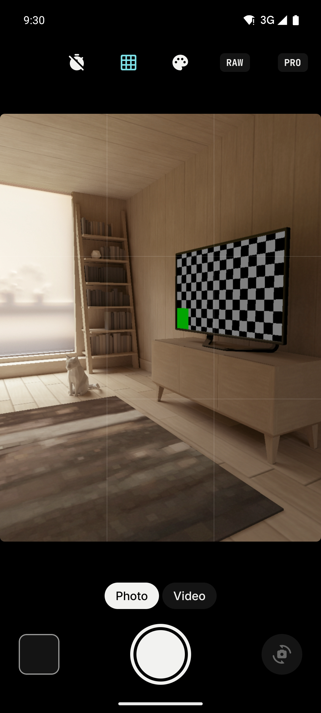
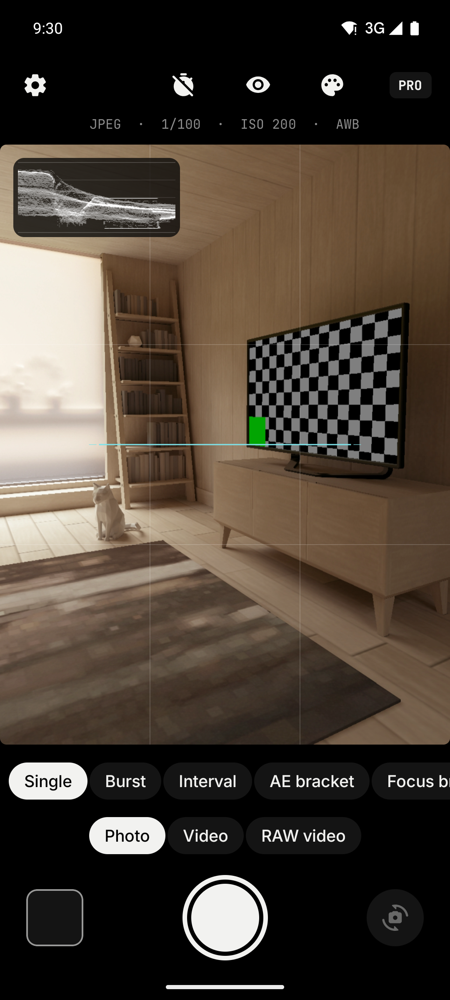
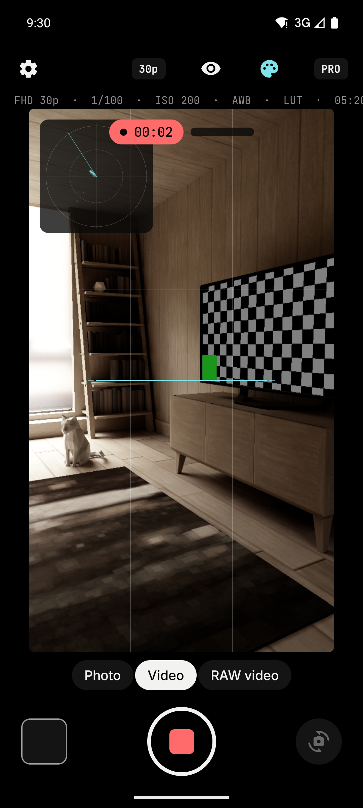
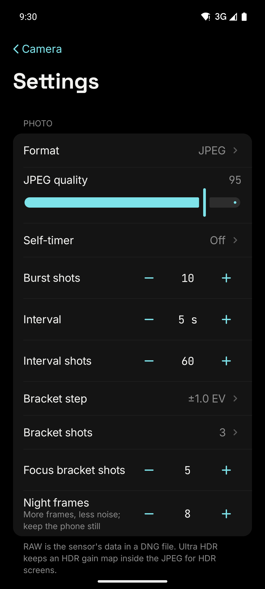

  

<h1 align="center">T.A.C.T.S.</h1>

<b>TOTALLY ACCURATE CAMERA TECHNOLOGY SYSTEM</b>

Pro camera for Android: manual control of the sensor, cinema monitoring tools, log profiles, LUTs and RAW video.

  
  
  

  
  
  
  

The toolset of the pro camera apps filmmakers use on phones, in one app, built on everything the
Android Camera2 API exposes. Every option is read from the camera first: what your phone cannot do is
hidden or says why.

## Features

**Exposure and focus**
- ISO and shutter speed in full stops, from 1/32000 s to 60 s within what the sensor allows
- **Shutter angle** for video (11.25° to 360°, 172.8° for 50 Hz light), following the frame rate
- Exposure compensation, **AE lock**, metering matrix / centre / spot
- Tap to focus; **long-press for a separate exposure point**, so focus and exposure are set apart
- Manual focus with an **A/B focus pull** eased over 0.5–8 s
- Antibanding 50/60 Hz, aperture and ND filter on lenses that have them, face detection
- Live readouts of what auto chose; switching to manual starts from them

**Colour and picture**
- White balance: auto, **AWB lock**, presets, or **Kelvin 2000–10000 K with tint**, computed from the
  sensor's own colour matrices
- **Gamma profiles** on the ISP's tonemap curve: Standard, Flat, Log, Log high contrast, HLG-like, Linear
- Noise reduction, sharpening, hot-pixel and lens-shading correction: off, fast, high quality or minimal
- **3D LUTs**: built-in ones (Log to Rec.709, Teal & orange, Bleach bypass, Warm film…) and your own
  **.cube** files; shown live on the preview, burnt into video on the GPU and applied to JPEG photos
- Eight looks (Natural, Vivid, Warm, Cool, Fade, Mono, Noir, Sepia) on preview, photo and video

**Video**
- SD, HD, FHD, 4K; **24, 25, 30, 48, 50, 60 fps**; bitrate Auto to 200 Mb/s
- **10-bit HDR**: HLG, HDR10, HDR10+, Dolby Vision where the phone supports it
- **Slow motion** at 120 / 240 fps on phones with high-speed video
- Stabilization: off, video, or preview + video; OIS on/off
- Audio on/off, source (camcorder, unprocessed, voice, mic) and a **live level meter**
- **Clip names like a cinema camera**: `A001_C001_YYMMDD`, with reel and clip counters
- Time-of-day **timecode** in the status line

**RAW video**
- The sensor's own data, frame by frame, as DNG files inside **one ZIP** in `Documents/TACTS/<clip>.zip`
  (Zip64, so clips can pass 4 GB); extract it and DaVinci Resolve and other graders open the DNGs as a clip
- Runs its own Camera2 session; frames written and dropped are shown live

**Monitoring**
- **Focus peaking** (five colours, adjustable), **zebras** (70–100 %), **false colour**
- **Waveform**, **RGB parade**, **vectorscope** with skin-tone line, luma and **RGB histograms**,
  clipping warning
- **Frame guides** 2.39, 2.35, 1.85, 16:9, 4:3, 1:1, 9:16, 4:5; **safe areas** 90 / 80 %
- **Anamorphic desqueeze** preview 1.33× to 2×
- **Horizon level**, centre mark, grids (thirds, golden ratio, crosshair, squares)
- A status line with format, frame rate, shutter, ISO, white balance, gamma, LUT and timecode

**Photo**
- JPEG (quality 70–100), **Ultra HDR**, **RAW (DNG)**, **RAW + JPEG**
- Drive modes in the format card: **single**, **burst**, **interval / timelapse**, **AE bracketing**
  (3–9 shots, ±0.3 to ±3 EV), **focus bracketing** for focus stacking
- Modes made from several frames, in the mode bar to the left of PHOTO. Each frame is aligned to the
  first tile by tile, and what moved between frames is taken from one frame only:
  - **Night**: 2–32 frames averaged to cut noise
  - **HDR**: three exposures (±1 to ±3 EV) fused, each part from the frame where it is best exposed
  - **Super-res**: 4–16 hand-held frames added on a grid twice as fine, 8160×6120 from 4080×3060 on a
    Galaxy S23. The detail gained is real but modest; it is not what a 50 MP sensor records, and the
    file's EXIF says how it was made
  - On a Galaxy S23 (release build, 8 frames): Night 2.5 s, HDR 1.7 s, Super-res 3.4 s from the last
    frame to the saved file
- **Presets**: save the current exposure, focus, colour, format and monitoring settings and apply them
  with one tap; the mode, lens and clip numbering stay as they are
- Self-timer, flash, low-light boost and torch strength where supported

**Camera**
- Front and back, and the **physical lenses** behind a multi-camera (ultra-wide, wide, tele) with
  their 35 mm equivalent
- A **lens capsule** with one button per real lens, named as the phone's own camera app names them
  (0.6, 1, 3 on a Galaxy S23; a 5× or 10× tele adds its own button). The figures come from each
  lens's focal length and sensor size, so they are right on any phone; a lens listed as a camera of
  its own, outside the main camera's zoom range, is opened directly
- Controls laid out after the iOS 26 camera:
  - **Top left**: the format pills (JPEG, 4K HLG, 30). A tap opens a card with every format, dynamic
    range, resolution, frame rate and drive mode the camera offers
  - **Top right**: flash, monitoring and looks in one capsule
  - **Over the frame**: one button per lens. Holding a lens or sliding across them turns a **zoom
    wheel**: log scale, the lenses marked on it, a tick felt as each one passes
  - **Mode bar**: PHOTO and VIDEO in the middle; Night, HDR and Super-res on the left, slow motion
    and RAW video on the right. A + on each side, a hold or a slide opens the bar toward that side
  - **ƒ**: the manual values (EV, ISO, shutter, focus, white balance) above the shutter; tapping one
    opens its dial: the value large, a ruler of ticks to drag, A for auto
  - **▦**: a sheet with every other control, and Settings
  - **Bottom corners**: the last capture (opens it in the gallery) and the camera switch
- The glass of T.A.R.K.A.S.: **liquid glass** (refraction and a lit rim, Android 13+), **frosted
  glass** or solid, in Settings → Interface. The glass blurs a small copy of the viewfinder, since
  the camera's own surface cannot be recorded; Android's "reduce transparency and blur" makes it solid
- **Camera info**: every Camera2 characteristic of every camera on the phone, a summary of what it
  supports, and its stream sizes
- Every setting is kept between launches

**Design**
- The T.A.R.K.A.S. design system: T.A.L. palette with the ice accent on a pure black page, Space
  Grotesk, Inter and JetBrains Mono, grouped settings lists
- One motion for the whole app: a spring without overshoot that settles in about 0.3 s. Controls rise
  into place, panels give their place to each other along one path, a focus or exposure mark appears
  where the finger touched, and every press answers with the same light wash. Large panels are a
  thicker glass than the small controls. With the system's animations off, things cross-fade

## Installation

Download the APK from the [latest release](https://github.com/TODDYNDOSVRAU/T.A.C.T.S/releases/latest) and install it. Updates install over the previous version.

The app asks for the camera, and for the microphone for sound in videos.

## Privacy

No account, no internet permission and no backend. Photos, videos and LUTs stay on the phone.

## Limitations

What the app can do depends on the phone's camera (Settings > Camera info shows it):

- **Manual ISO, shutter and focus** need the Camera2 `MANUAL_SENSOR` capability; **Kelvin** needs
  `MANUAL_POST_PROCESSING`, otherwise the nearest preset is used; **gamma profiles** need tonemap
  curve support. Most mid- and high-end phones have them; LEGACY and many LIMITED cameras do not.
- **RAW video** needs the `RAW` capability. Frames are written as uncompressed DNG, so the frame rate
  that reaches storage depends on the phone (on a Galaxy S23, about 10 of 181 frames were dropped in
  6 s); dropped frames are counted on screen and in the final notice.
- Which physical lens streams at a given zoom is the phone's choice. On a Galaxy S23, 3× in 4K HLG
  video stays on the wide lens, cropped (in photo, 3× uses the tele). Settings → Lenses can lock one
  lens; that lock is not yet tested with 10-bit video.
- No sound is recorded with RAW video.
- **Zero shutter lag** is off by default: on a Galaxy S23 it froze the preview whenever the zoom
  changed lens. It can be turned on in Settings, with that risk.
- Log profiles are curves on the phone's image processor, not a manufacturer's log.
- Night, HDR and Super-res need the JPEG format, and work from the phone's processed JPEGs, not RAW;
  choosing one of them switches the format to JPEG and says so. HDR does not yet keep moving things
  from doubling. Super-res's gain in detail has not yet been
  measured on a lit test scene. Presets are not yet tested on the phone.
- On a phone that reports a resolution higher than 12 MP only to its maker's own apps (the Galaxy S23
  with its 50 MP and 8K modes), third-party apps, this one included, get 12 MP and 4K30 at most.
- LUTs and looks are burnt into 8-bit video only, not into 10-bit HDR or slow motion.
- Slow motion needs a high-speed profile that CameraX can read for the camera; some phones (the Galaxy S23 among them) list 120 fps in Camera2 only, and then the mode is hidden. It records without sound, as the platform's high-speed mode does.

## Roadmap

A dual-camera picture-in-picture mode, external microphones with
gain, and compressed RAW video.

## Tech

Kotlin · Jetpack Compose · Material 3 · CameraX (core, camera2 interop, video, view, high-speed
sessions, effects) · Camera2 · OpenGL ES 2 · DataStore · Space Grotesk, Inter and JetBrains Mono
([OFL](docs/licenses/fonts))

| Area | Files |
| --- | --- |
| Engine | [`camera/TactsCamera.kt`](app/src/main/java/com/tacts/camera/camera/TactsCamera.kt): binding, capture, video, photo modes, focus pull |
| Camera2 requests | [`camera/RequestOptions.kt`](app/src/main/java/com/tacts/camera/camera/RequestOptions.kt): exposure, Kelvin, gamma curves, processing |
| Capabilities | [`camera/CameraCaps.kt`](app/src/main/java/com/tacts/camera/camera/CameraCaps.kt) |
| Settings | [`camera/Settings.kt`](app/src/main/java/com/tacts/camera/camera/Settings.kt) |
| RAW video | [`raw/RawVideoEngine.kt`](app/src/main/java/com/tacts/camera/raw/RawVideoEngine.kt) |
| Scopes | [`monitor/Scopes.kt`](app/src/main/java/com/tacts/camera/monitor/Scopes.kt) |
| LUTs and GPU effect | [`effects/Lut.kt`](app/src/main/java/com/tacts/camera/effects/Lut.kt), [`effects/LutProcessor.kt`](app/src/main/java/com/tacts/camera/effects/LutProcessor.kt) |
| Interface | [`ui/`](app/src/main/java/com/tacts/camera/ui) |

## License

All rights reserved. Personal use of the official APKs is permitted; copying, modification, redistribution and commercial use are prohibited without written permission. See [LICENSE](LICENSE) (Portuguese).

## Contact

Roger Moreira · roger.moreiraa8@gmail.com
